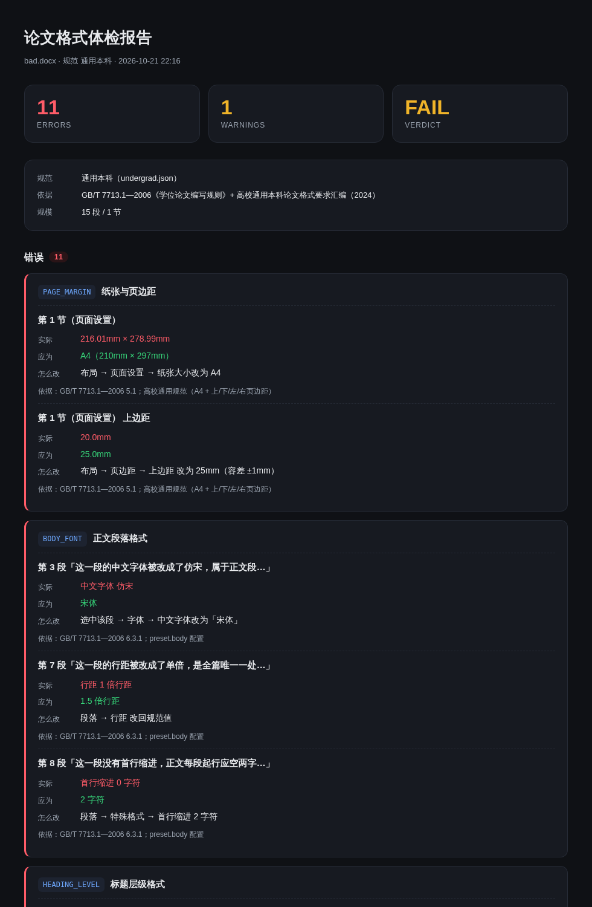
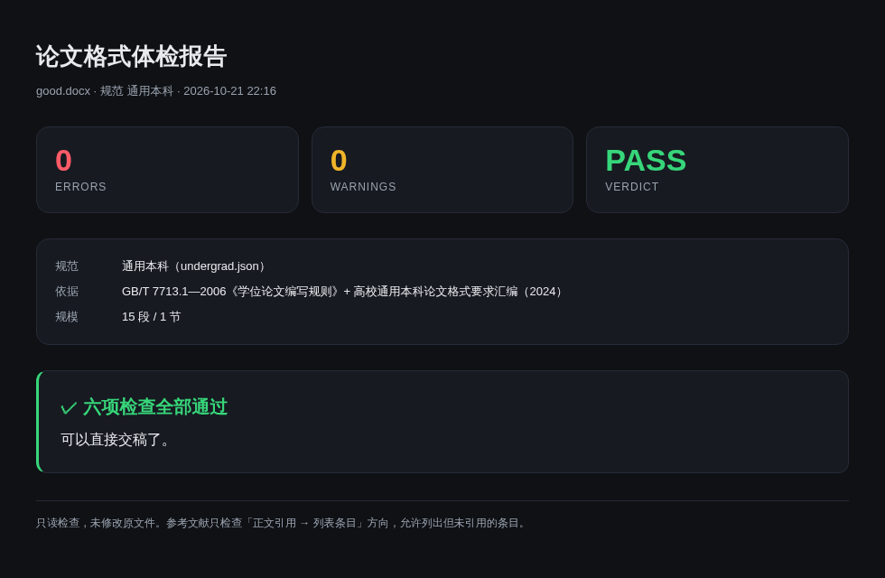

# thesis-lint

**一条命令，给你的学位论文做格式体检：`python cli.py check thesis.docx`。**



纯本地、零第三方依赖。输入一份 `.docx`，输出一份能照着改的格式问题清单：哪一项、在第几段、实际是什么、应该是什么、怎么改。

不用大模型，不上传论文正文，不联网。规则引擎，同样的输入永远给同样的结果。

## 为什么值得信

- **不上传、不联网、不改原文件。** 只用 Python 标准库的 `zipfile` + `xml.etree` 直接读 `.docx` 里的 XML，跑前后原文件 sha256 不变（有测试守着）。
- **每条规则都有出处。** 报告里每个问题都带 `依据`，写的是国标条款号（GB/T 7713.1—2006、GB/T 7714—2015），不是「我觉得应该这样」。
- **规则会被证明「会失败」。** 仓库里有一份逐项做坏的 `bad.docx`，和 `tools/verify_rules_go_red.py` —— 把任一规则改坏，对应测试立刻变红。

## 快速开始

需要 Python 3.10+，不需要 `pip install` 任何东西。

```bash
python cli.py check thesis.docx
python cli.py check thesis.docx --preset master --out report.md
python cli.py check thesis.docx --html report.html
python cli.py presets
```

终端输出按错误/警告分组，末行汇总 `X errors, Y warnings`：

```
错误（2）
  PAGE_MARGIN  纸张与页边距
    ✗ 第 1 节（页面设置） 上边距
      实际：20.0mm
      应为：25.0mm
      怎么改：布局 → 页边距 → 上边距 改为 25mm（容差 ±1mm）

11 errors, 1 warnings
```

`--html` 生成单文件报告（内联 CSS），可离线打开、可直接截图发群：

```bash
python cli.py check thesis.docx --html report.html && open report.html
```

全部通过时是这样的：



## 退出码

| 情况 | 退出码 |
|---|---|
| 有 error | `1` |
| 只有 warn | `0` |
| 没有问题 | `0` |

可以直接串进脚本：`python cli.py check thesis.docx || echo "先改完再交"`

## v0.1 只查这 6 项

| # | 检查项 | `rule_id` | 判据 |
|---|---|---|---|
| 1 | 纸张与页边距 | `PAGE_MARGIN` | A4；上/下/左/右按 preset 比对，容差 ±1mm |
| 2 | 正文段落格式 | `BODY_FONT` | 中文字体、字号、行距、首行缩进、段前段后间距 |
| 3 | 标题层级格式 | `HEADING_LEVEL` | 一/二/三级标题各自字体、字号、加粗；层级不得跳级 |
| 4 | 行距 | `LINE_SPACING` | 按 preset 比对，并报「同一篇里行距不统一」 |
| 5 | 首行缩进 | `INDENT` | 正文 2 字符；标题、图表题注、参考文献条目不缩进 |
| 6 | 参考文献序号连续性 | `REF_NUMBERING` | 列表序号从 1 连续无重复；正文 `[n]` 都能找到条目 |

**明确不查**（留给 v0.2）：目录域、图表题注格式、页码位置、GB/T 7714 逐字段著录、公式编号、页眉页脚。

### 关于参考文献的反向对应

只查「正文引用 → 列表条目」这个方向。列表里有、正文没引用的条目**不算错**——很多学校允许「未引用但列出」。报告里会写清这一条，免得你为了消掉警告去删有用的文献。

## preset：你的学校有自己的规矩

格式标准在不同学校之间会变，所以判据全部放在 `presets/*.json`，不写死在代码里。

```bash
python cli.py presets
```

自带三个：

- `undergrad.json` —— 通用本科（宋体小四、1.5 倍行距、上/下 25mm、左 30mm、右 25mm）
- `master.json` —— 通用硕博（固定值 20pt 行距、上边距 30mm、一二级标题加粗）
- `gb-7714.json` —— 国标基线（只写国标明文规定的项）

每个 preset 必须带 `name`、`description`、`source` 三个元字段，`source` 就是报告里显示的「依据」，缺了直接报错。

自己学校另有一套？复制一份改数值就行，`--preset ./我的学校.json` 也吃绝对/相对路径：

```json
{
  "name": "XX 大学本科",
  "description": "XX 大学 2024 届本科毕业论文格式要求",
  "source": "《XX 大学本科毕业论文（设计）撰写规范》第三章",
  "page": { "margin_top_mm": 30, "margin_bottom_mm": 25, "margin_left_mm": 30, "margin_right_mm": 25, "tolerance_mm": 1 },
  "body": { "font_east_asia": "宋体", "size_pt": 12, "first_line_indent_chars": 2, "space_before_pt_max": 0, "space_after_pt_max": 0 },
  "line_spacing": { "rule": "auto", "value": 1.5 },
  "headings": {
    "1": { "font_east_asia": "黑体", "size_pt": 16, "bold": false },
    "2": { "font_east_asia": "黑体", "size_pt": 14, "bold": false },
    "3": { "font_east_asia": "黑体", "size_pt": 12, "bold": false }
  },
  "references": { "heading_text": "参考文献", "style": "GB/T 7714-2015 顺序编码制" }
}
```

## 问题长什么样

每个问题是一个结构体：

```python
{
  "rule_id": "BODY_FONT",
  "level": "error",                       # error | warn
  "location": "第 3 段「这一段的中文字体被改成了仿宋，属于正文段…」",
  "actual": "中文字体 仿宋",
  "expected": "宋体",
  "fix_hint": "选中该段 → 字体 → 中文字体改为「宋体」",
  "source": "GB/T 7713.1—2006 6.3.1；preset.body 配置",
}
```

`location` 是「段落序号 + 该段前 20 字」，因为「第 3 段」在 Word 里不好数，看到开头几个字才能一眼找过去。页面级问题定位到「第 N 节（页面设置）」。

## 项目结构

```
thesis-lint/
├── cli.py                # 命令行入口
├── core/
│   ├── docx.py           # zip + XML 解析层，唯一碰 .docx 的地方
│   ├── model.py          # Paragraph / Section / Doc
│   ├── presets.py        # preset 加载与校验
│   ├── checker.py        # 解析 + 规则 + 结果
│   ├── report.py         # 终端 / Markdown / HTML 渲染
│   └── rules/            # 每个检查项一个文件
├── presets/              # 规范 JSON
├── fixtures/             # good.docx / bad.docx / per_rule/*.docx
├── tests/                # 反例 + 正例 + 退出码 + 只读
└── tools/                # 生成 fixtures、验证规则会变红
```

## 开发

```bash
python3 -m unittest discover -s tests -t . -v   # 全部测试
python3 tools/build_fixtures.py                 # 重新生成 fixtures
python3 tools/verify_rules_go_red.py            # 证明每条规则会失败
```

`fixtures/` 里的 `.docx` 是 `tools/build_fixtures.py` 用手工拼的 OOXML 生成的，没有二进制黑盒，改坏了直接重跑。

English version: [README.en.md](README.en.md)
